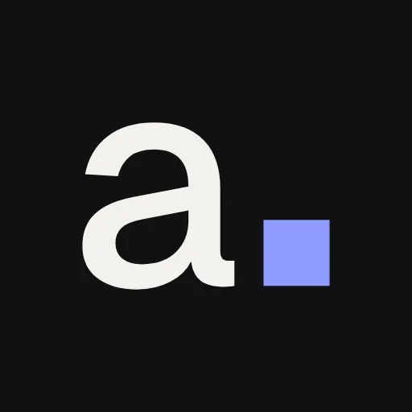

# Avence Studio

> O nosso estúdio, tratado aqui como cliente: sites e páginas de captação para empresas de serviços que já anunciam, com o caminho até o WhatsApp ou o pedido de proposta.

**Estado:** ativo (site novo no ar desde 2026-10-15; campanhas da Meta rodando)
**Conta:** 9388568a-eb7d-42b2-b263-9ffc7fca9d91 (conta da casa)
**Atualizado em:** 2026-11-06

## Quem é

- São Leopoldo (RS), @avencestudio, avencestudio.com.
- Vende o projeto cobrado uma vez e um plano mensal opcional. Processo acompanhado num link: conversa, direção, prévia, ajustes e publicação.
- Público prioritário: donos de empresas de serviços que já anunciam ou vão anunciar (arquitetura, advocacia, contabilidade, clínicas). Lojas virtuais ficam fora deste ciclo.
- A Sinfy é bastidor: nunca aparece na comunicação da Avence.

## Estado agora (2026-11-06)

- **Site:** 573 visitas e 10 contatos desde 25/10; 79% das visitas vêm de Meta Ads, a maior parte para `/formlp/` e `/arq-lp/` ([Site e anúncios](site-e-anuncios.md)).
- **Anúncios (30 dias, Meta):** R$ 386,06 investidos, 11.086 pessoas alcançadas, 431 cliques no link, 9 leads, 12 conversas.
- **Formulários:** "Captação com agendamento" (`/f/trafego-corretoras`) com 8 envios; "Arquitetos · proposta de site" e "Site e página de vendas" com 2 cada.
- **Conteúdo:** 76 conteúdos no Plano: 6 aprovados, 9 em revisão, 55 em produção, 6 ideias ([Conteúdo](conteudo.md)).
- **Instagram:** 57 seguidores, 17 posts.
- **CRM:** 557 empresas como lead (quase todas da Prospecção) e 2 clientes.

## Próximos passos

1. Fechar a medição da campanha: conversão do Google Ads, pixel e caixa de e-mail da página de proposta.
2. Aprovar e programar a pauta de novembro (foco em arquitetos).
3. Subir as imagens dos cases para a mídia do WordPress (hoje carregam do app).

## Notas desta pasta

- [Cases](cases.md) · [Marca](marca.md) · [Conteúdo](conteudo.md) · [Site e anúncios](site-e-anuncios.md) · [Decisões](decisoes.md) · [Log](log/) · [Mídia](midia/)
