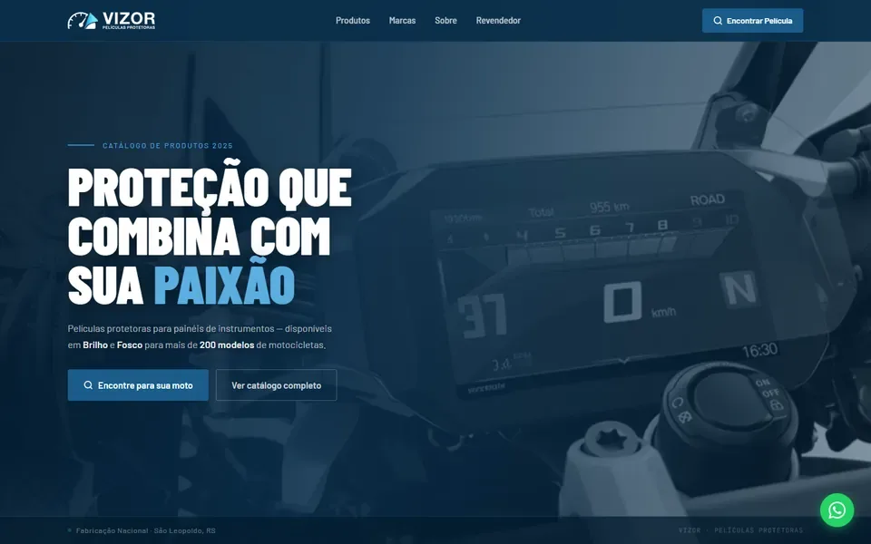
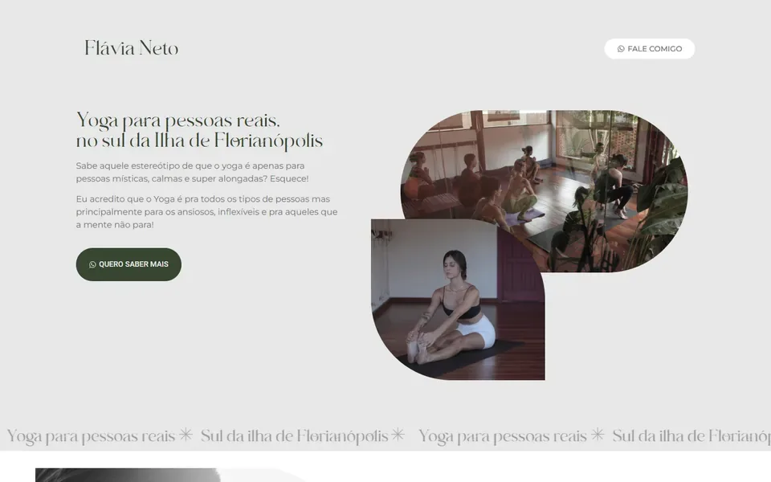
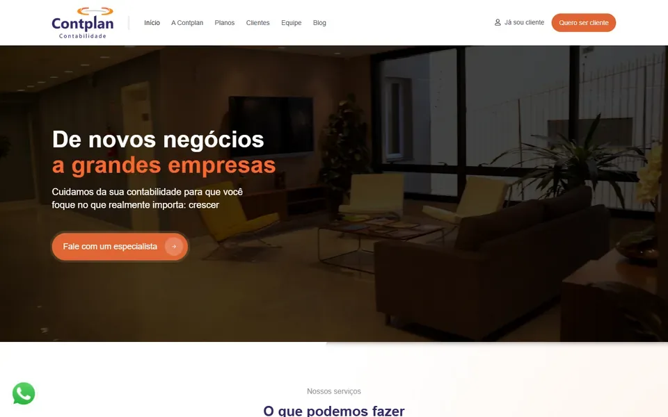
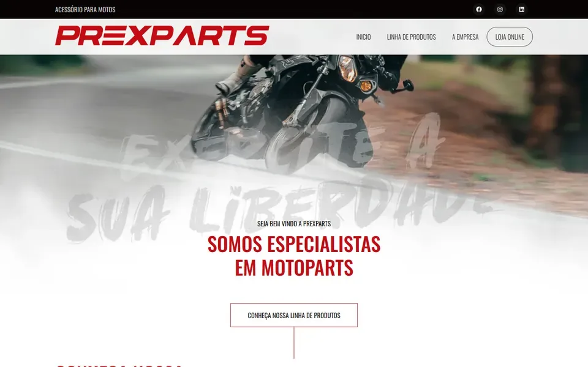

# Cases · Avence

Os seis sites no ar que mostramos. Só dizemos o que o site mostra: nome, segmento, plataforma. Autorização de cada cliente para uso como case: **a confirmar**.

| Case | Plataforma | Capa |
| --- | --- | --- |
| ProcessBase | WordPress + Elementor |  |
| Vizor Películas | Astro |  |
| Flávia Neto | WordPress + Elementor |  |
| Zena Viagens | WordPress + Elementor |  |
| Contplan | WordPress + Elementor |  |
| PrexParts | WordPress + Elementor |  |

## O efeito do ProcessBase

O case mostra o efeito de rolagem do site, não um print:

[processbase-efeito](midia/2026-11/processbase-efeito.mp4)
