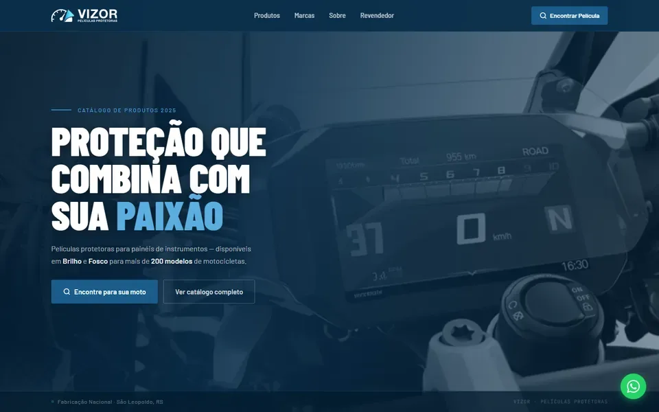

# Vizor Películas

> Fabricante de películas protetoras para o painel de motos, em São Leopoldo (RS). Cliente piloto da Sinfy: jornada completa (site → lead) e criativos em volume.

**Estado:** em produção (piloto)
**Conta:** a247fefc-2b42-4b7c-bc76-185515063c98
**Atualizado em:** 2026-11-06

## Quem é

- Mais de 200 modelos de 17 marcas (Honda, Yamaha, BMW, Kawasaki, Ducati, Harley-Davidson, Triumph, KTM, Royal Enfield e outras), cada um em **Brilho (VZB)** e **Fosco (VZF)**.
- Vende pelo WhatsApp, pelo localizador de película no site e por revendedores.
- Público: motociclistas (de CG e Biz a GS e Panigale) e lojas, oficinas e instaladores que podem revender.
- Tagline: "Proteção com propósito." · "100% nacional · São Leopoldo, RS".
- Site: [vizorpeliculas.com.br](https://vizorpeliculas.com.br) (Astro, repositório `bloqxstudio/Vizorpeliculas`, publicado pela Hostinger a partir da `main`).
- Instagram: @vizorpeliculas.

## O que fazemos com ela

1. **Analytics da jornada**: rastreador do site, formulário de revendedor mandando lead ao CRM, evento da busca de película.
2. **Criativos em volume** na marca da Vizor, com a @protlepeliculas como referência de formato ([referência](referencia-conteudo.md)).
3. **Site**: primeiro site a passar pelo editor "Sites em código" (Astro).

## Estado agora (2026-11-06)

- Plano da conta preenchido (oferta, público, tom, objetivo, restrições, 7 pilares): [Conteúdo](conteudo.md).
- Pauta com **28 conteúdos**: 26 ideias e 2 em produção. Nenhum aprovado ainda.
- Site: só **2 visitas** registradas (3 e 4/11): o rastreador quase não está contando. Ver [Site e números](site-e-numeros.md).
- Instagram: **61 seguidores**, 43 posts (leitura de 2026-11-06).
- Ainda não anunciam.

## Próximos passos

1. Conferir se o `visitas.js` está no ar no site publicado (2 visitas em 3 dias não bate com um site no ar).
2. Aprovar a primeira leva da pauta e produzir os criativos na marca.
3. Editar o site pelo "Sites em código" com o repositório real.
4. Quando começarem a anunciar: ligar a conta de anúncios.

## Notas desta pasta

- [Marca](marca.md) · [Conteúdo e pauta](conteudo.md) · [Referência @protlepeliculas](referencia-conteudo.md) · [Site e números](site-e-numeros.md) · [Decisões](decisoes.md) · [Log](log/) · [Mídia](midia/)
