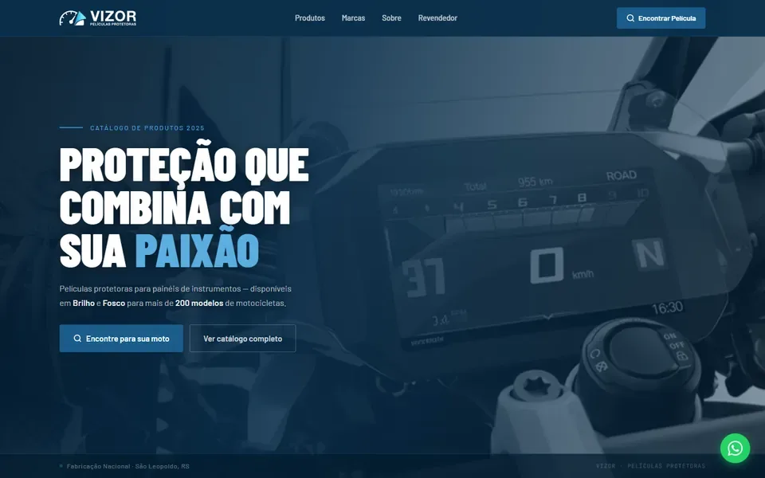

# Início do piloto

**Data:** 2026-11-03 · **Iniciativa:** vizor-peliculas · **Quem:** Igor, com o Claude Code

## O que aconteceu

Conta "Vizor Películas" criada no app. O site ganhou o rastreador, o lead do formulário de revendedor e o evento da busca de película (commit `3f43692` no repositório da Vizor, autorizado pelo Igor).

## O que entregamos

- Plano preenchido a partir do brief e do design system da Vizor.
- Marca da conta (`brands/vizor-peliculas/DESIGN.md`).
- Leitura da @protlepeliculas e pauta inicial de 15 conteúdos.

## Próximo passo

Aprovar a pauta e produzir os primeiros criativos.
