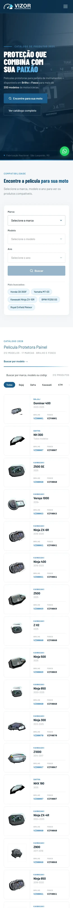

# Site e números · Vizor

**Atualizado em:** 2026-11-06 (lido do banco do app)

## O que está ligado no site

- `visitas.js` no `Layout.astro` (rastreador próprio da conta).
- Formulário "Quero ser revendedor" manda o lead ao CRM da conta (continua gravando também no Supabase da Vizor).
- Localizador emite o evento `busca_pelicula` (marca, modelo, ano, resultados).
- Cliques no WhatsApp contados pelo próprio `visitas.js`.

## Números

| Métrica | Valor | Período | Fonte |
| --- | --- | --- | --- |
| Visitas registradas | 2 | 03/11 a 04/11 | `site_sessions` |
| Pessoas | 2 | 03/11 a 04/11 | `site_sessions` |
| Contatos (WhatsApp, telefone, formulário) | 0 | 03/11 a 04/11 | `site_sessions` |
| Seguidores no Instagram | 61 | 06/11 | `crm_instagram_accounts` |
| Posts no Instagram | 43 | 06/11 | `crm_instagram_accounts` |
| Investimento em anúncios | — | ainda não anunciam | — |

**A confirmar:** 2 visitas em 3 dias sugere que o rastreador não está em todas as páginas publicadas, ou que o commit `3f43692` não foi publicado.
